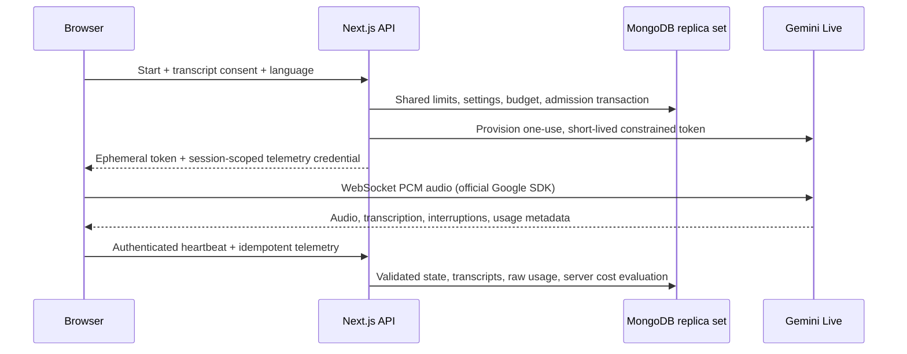

# Mercantile Marine Academy — AI assistant & administrator workspace

A Next.js App Router application for Mercantile Marine Academy, with a focused voice interface, Gemini Live browser streaming, MongoDB persistence through Prisma, and a protected usage dashboard. The included organizational content is clearly labelled sample guidance, **not verified Academy information**.

## Run the demo

Use Node.js 22.12+ and npm.

```bash
npm ci
cp .env.example .env
npm run dev
```

Open `http://localhost:3000`. The demo conversation is a scripted text preview: it never requests the microphone, connects to Gemini, or writes records. `/admin/login` has an **Explore demo dashboard** button. Demo admin APIs require that explicit entry, return separate in-code example records, and reject mutations. Demo cookies never authorize live access.

`DEMO_MODE=true` explicitly selects demo mode. If that variable is absent, demo mode is selected only when **both** `DATABASE_URL` and `GEMINI_API_KEY` are absent. Partially configured live environments fail visibly rather than silently displaying sample data.

## Configure the real integration

1. Create MongoDB Atlas, or use a MongoDB replica set. Transactions are required for admission control, telemetry updates, account setup and consistent deletion.
2. Set the following in `.env` locally or your deployment's secret manager:

   - `DEMO_MODE=false`
   - `DATABASE_URL`: MongoDB connection URI **including the database name**, TLS and appropriate credentials.
   - `GEMINI_API_KEY`: a server-only Google API key with access to the supported Live model.
   - `BETTER_AUTH_SECRET`: at least 32 cryptographically random characters.
   - `BETTER_AUTH_URL`: the exact application origin, such as `https://voice.example.org`. Production must use HTTPS.
   - `CRON_SECRET`: a separate high-entropy secret for the cleanup endpoint.
   - `TRUSTED_IP_HEADER`: optional. Only configure a header your reverse proxy **overwrites and validates**. Otherwise public session and login limiting deliberately use a shared global client bucket. Never trust a user-supplied forwarding header.

3. Synchronize the MongoDB schema and seed safe initial settings:

```bash
npm run db:generate
npm run db:push
npm run db:seed
```

`prisma db push` is the supported synchronization mechanism. **Do not use Prisma Migrate or create SQL migration files.** Seed is repeatable and does not overwrite settings or create pretend live usage/prices. Seeded FAQs are disabled and marked sample, so they cannot enter agent context.

4. Create an administrator from a trusted operator shell. There is no public registration and no default password:

```bash
read -r -p 'Administrator email: ' ADMIN_EMAIL
read -r -s -p 'Password (12–128 characters): ' ADMIN_PASSWORD
export ADMIN_EMAIL ADMIN_PASSWORD
npm run admin:create
unset ADMIN_EMAIL ADMIN_PASSWORD
```

Optionally supply `ADMIN_NAME`. The script creates the user and credential account in a transaction, hashes the password with Better Auth's scrypt implementation, and refuses to overwrite an existing account. It never logs the password. Do not put administrator passwords in source code, command arguments, or committed configuration.

5. Sign in at `/admin/login`, review agent settings, replace sample FAQs with verified content, configure official prices if available, and complete the live verification checklist before opening public access.

## Pages and everyday operation

| Route                  | Purpose                                                                                 |
| ---------------------- | --------------------------------------------------------------------------------------- |
| `/`                    | Voice conversation, language choice, notice/consent, transcript and microphone controls |
| `/admin/login`         | Administrator authentication or explicit demo entry                                     |
| `/admin`               | Date-filtered overview, daily/weekly activity and spending, recent conversations        |
| `/admin/sessions`      | Search, status/date filters, 10-row pagination, CSV export                              |
| `/admin/sessions/[id]` | Transcript, usage events, settings/pricing snapshot and deletion                        |
| `/admin/knowledge`     | Create, edit, delete, enable and categorize FAQs; preview approved context              |
| `/admin/settings`      | Instructions, welcome message, model, voice, language, limits and timezone              |
| `/admin/pricing`       | Create immutable model-pricing versions with source and effective date                  |
| `/admin/budget`        | Thresholds, alerts, optional INR display and separate service expenses                  |

Change instructions in **Agent settings**. New sessions snapshot the instructions, settings, language and knowledge; changing them does not affect an existing connection. Only non-sample, enabled FAQs enter context. Mark an entry non-sample only after verifying its organizational facts. Course eligibility, fees, and certification details must be confirmed by academy staff.

Knowledge retrieval is isolated in `lib/services.ts:approvedKnowledge`: at most 20 recent enabled/non-sample entries and 12,000 characters. The initial editor caps entries at 200; replace this abstraction with indexed retrieval for a larger corpus. No arbitrary document instructions or tools are executed.

The dashboard polls every 30 seconds. Aggregation is server-side; the browser only receives chart buckets, summary counts and paginated rows. Stored timestamps are UTC. Display timezone defaults to Asia/Kolkata and is configurable. Explicit date filters select UTC dates; chart labels use the configured display timezone. Budgets use UTC calendar days/months. CSV export respects filters, caps at 5,000 rows, and neutralizes spreadsheet formula prefixes. Details show the first 1,000 transcript/usage records; export larger histories through authorized database tooling.

## Architecture



The permanent Gemini key is only read on the server. Tokens are restricted to the selected model, voice, system instructions, audio modality and transcription configuration. New connections must begin within 30 seconds; token expiry matches the configured session maximum. Only the ephemeral token enters the browser. The independent telemetry credential is random, stored as a SHA-256 hash, and scoped to one session with a short finalization grace period.

The browser uses an AudioWorklet for mono PCM16 little-endian input. AudioContext requests 16 kHz; the actual rate is declared in the MIME type, as required by Google's resampling contract. Output PCM is decoded at 24 kHz and scheduled in Web Audio. An interruption synchronously stops and disconnects every queued source. Mute flushes the audio input stream; end/disconnection stops microphone tracks, playback, contexts, nodes and timers. Delayed permission/connect responses check cancellation. There is no automatic microphone restart or session resumption.

Maximum duration is limited to 540 seconds, below the documented connection refresh interval. Provider `goAway` ends the conversation with an explicit restart prompt. The user must start a new session.

No separate persistent backend is required: **the browser owns the Gemini WebSocket**. Next.js handlers provision tokens and persist telemetry using short requests. This is compatible with serverless deployments; no route handler hosts a persistent WebSocket.

### Persistence and concurrency

- Prisma 6.19.3 and `@prisma/client` 6.19.3 are pinned to the MongoDB-compatible release line.
- ObjectId primary keys and related document IDs use `@db.ObjectId`.
- A reusable Prisma client prevents development hot reload from creating clients repeatedly.
- Transcripts and usage events are separate collections with unique `(sessionId, eventId)` indexes.
- Retried events do not increase counts or costs. Transcript partials update a stable document and cannot overwrite a finalized message with an old partial retry.
- All session admissions update one shared settings revision inside a MongoDB transaction. Competing admissions conflict and retry before the concurrency check can admit too many sessions.
- Capacity is conservatively reserved until the issued token expires, even after an early user end or missed heartbeat. This prevents a client from freeing a slot while continuing a direct provider connection. Provisioning failures release their reservation.
- Session transitions are server-validated. Heartbeats run every 10 seconds; 90 seconds without activity expires the application session. Gemini token expiry independently bounds the provider connection.
- Anonymous public rate limits and an additional login limit use atomic MongoDB counters shared by all instances. Better Auth also applies its own database-backed rate limits.
- Every admin endpoint verifies a server session and admin role. The protected layout guards pages; it is not the only authorization check. Better Auth uses HTTP-only session cookies and secure cookies for HTTPS origins.
- Session deletion rejects active sessions and transactionally deletes the related transcript/usage records. MongoDB foreign keys are not assumed.

## Usage and estimated costs

**Automatic live cost totals are intentionally incomplete until the selected model's accounting periods are independently verified.** Google's Live documentation describes periodic response metadata, but does not unambiguously establish the accounting period for every counter in the selected model. Summing those snapshots or treating them as simple cumulative session counters would risk substantial over/under-counting. The app does not invent that interpretation.

Browser events preserve raw metadata, modality breakdowns, source `BROWSER`, trust `PROVISIONAL`, counter mode `UNKNOWN` and an explicit unverified period. The latest available provider token snapshot can be displayed, but is not presented as a billable total. Unknown periods are not aggregated into costs. Missing pricing displays **Pricing unavailable**; unverified/missing usage displays **Incomplete**. Neither is represented as a zero-priced conversation.

The server accounting module supports incremental events and per-period cumulative high-water marks, deduplicates event IDs, rejects mixed counter interpretations for a period and detects missing usage/pricing categories. Cache input must be separated from uncached input before calculating; do not count cached tokens in both categories. Additional thoughts/tool categories require documented billing treatment. The reviewed import requires explicit zero values for categories confirmed absent, rather than guessing zeros from missing metadata.

Pricing versions store the model, USD currency, decimal-string rates per million tokens, official source URL, effective timestamp, and creation timestamp. They are immutable. Sessions reference the version effective at start. No Google price or exchange rate is seeded. Verify rates at the [official Gemini pricing page](https://ai.google.dev/gemini-api/docs/pricing).

Arithmetic uses `decimal.js` at 50 significant digits, with **ROUND_HALF_UP to 12 decimal places only when persisting the summed session estimate**. Display rounding is separate (dashboard summaries: 2 places; session rows: 4). MongoDB sums stored exact strings after converting them to BSON decimal inside aggregation. There are no unsupported Prisma Decimal fields, and duration is never used to calculate API spending. Incomplete partial estimates are excluded from spending totals.

### Reconcile verified billable usage

A trusted operator can import a complete, independently reviewed billable session snapshot:

```bash
npm run usage:reconcile -- /secure/path/reviewed-usage.json
```

The input shape is documented in [docs/reconciliation.example.json](docs/reconciliation.example.json). It is a **format example, not actual billable data**. Replace all identifiers and values with reviewed data; record its evidence URL and reviewer. Normalized input categories must exclude cache amounts; thinking/tool counts must not also be included in output unless provider pricing expressly requires it. Do not manufacture zeros for categories whose usage is unknown.

Only ended live sessions can be reconciled. The pricing model/effective date must match and an existing session pricing reference cannot be silently replaced. A session that had no price may be assigned a reviewed historical version effective at its start. Each import is immutable and idempotent. The newest reviewed full-session snapshot replaces previous accounting rather than adding to browser events; original events remain available for audit. Estimates remain estimates, not invoices. If the provider cannot supply unambiguous session-level billable data, leave the session incomplete.

### Budgets and other expenses

Daily/monthly thresholds create dashboard alerts. Optional blocking stops new sessions at a reached threshold **or when a configured period contains incomplete spending**. This is deliberately fail-closed when spending is unknown. Disable that option if continued access is preferred while usage is being reconciled. Duration, concurrency and request-rate limits remain enforced regardless.

Admission and provider billing are asynchronous; existing sessions can continue until expiry. Estimated-spending controls cannot promise an exact billing cap. Use the provider's own quota controls as well. Alerts are stored locally in the dashboard; no email or SMS is sent.

An administrator can supply an INR-per-USD rate and effective date; INR values are illustrative displays in the budget page. Hosting and telephone/other expenses are optional, stored/displayed separately, and never added to Estimated API Cost.

## Retention and deletion

The notice must be acknowledged before a live or sample conversation starts. This app does not store raw audio. Google still processes audio under the terms applicable to your provider account; review your provider data settings before handling personal information.

Configure transcript retention in Agent settings (1–365 days). Each session snapshots its expiry, so later changes apply to new sessions. Schedule an authenticated **POST** to `/api/cron/retention` every minute, with `Authorization: Bearer <CRON_SECRET>`. Configure the secret in the scheduler's secret store; never embed it in a public URL. GET is intentionally unsupported.

Each run expires up to 200 stale sessions, deletes transcripts for up to 500 due sessions, marks those sessions purged to prevent batch starvation, and removes old application rate buckets. Run more frequently for high volume and alert on job failures. Financial/session metadata and usage events remain until an administrator deletes the session. Set a separate organizational metadata-retention policy if needed. Provider usage metadata should not contain audio or transcript text; raw payloads are size-limited but browser reports are untrusted.

Full session deletion removes both transcript and usage collections in the same transaction. It is separate from transcript-only retention. Deleting current-period accounting records also changes displayed estimates and budget totals; retain reviewed financial evidence elsewhere if required by your operating policy.

## Deployment

1. Deploy with a Node-compatible Next.js host, or run `npm run build` followed by `npm run start` behind an HTTPS reverse proxy.
2. Run `npm ci` with development dependencies in the build stage so Prisma and the compiler are available. `postinstall` generates the client. Use a separate build/release task for `db:push`; do not race schema changes across application instances.
3. Set the live environment values, exact public origin and secure cookie settings; keep secrets in the host's secret manager. Never use `NEXT_PUBLIC_GEMINI_API_KEY` or expose a permanent key in telemetry/logging.
4. Allow deployment egress to MongoDB Atlas and Google's token service; allow browsers to connect to Google's WebSocket service. Configure Atlas network access and connection pool limits for the expected instance count.
5. Enforce an ingress request-body limit (64 KiB for telemetry) and configure the trusted client IP header only when the reverse proxy strips incoming spoofed copies. The application also bounds streamed JSON body reads.
6. Schedule the POST cleanup job, configure operational uptime monitoring, and run [docs/verification.md](docs/verification.md).

No telephone transport or separate WebSocket server is implemented. A future telephone gateway or server-authoritative audio proxy would require a separately deployed persistent WebSocket service (container/VM) and a new authenticated transport; it should not be placed in serverless route handlers.

### Backups and backfills

Use Atlas automated snapshots/PITR where available for your tier, or authenticated `mongodump` from a trusted environment. Keep backup credentials outside shell history, encrypt backup storage, limit access, and periodically test `mongorestore` into a separate replica set. Pause public sessions before a restore; verify indexes, admin access and retained data after restoration. See [Atlas backup documentation](https://www.mongodb.com/docs/atlas/backup-restore-cluster/).

`db push` changes the schema/indexes but does not rewrite existing documents. Back up first and run explicit, reviewed data backfills. For example, older VoiceSession documents need `transcriptPurged: false`, `revision: 0`, and other newly required fields initialized using a MongoDB script before deploying code that queries them. Derive `transcriptExpiresAt` from the original start time and an explicitly chosen historical policy. Never backfill a missing price or usage counter as zero. User-role backfills must use an explicit administrator allowlist, not grant admin to everyone.

## Troubleshooting

- **Microphone denied:** allow microphone access in browser site settings, check OS permissions and use HTTPS/localhost. Click Start again; capture never resumes automatically.
- **Microphone unavailable:** check another app is not exclusively using the device; confirm AudioWorklet and Web Audio support. Prefer headphones to reduce acoustic echo.
- **Gemini unavailable:** verify server API key, model access, provider quota, outbound access, token API version, clock synchronization and exact origin. The UI stops recording when connection/logging fails. Restart explicitly after expiration; expired tokens are not reused.
- **MongoDB unavailable:** confirm database name in URI, network allowlist, TLS, credentials, schema synchronization and replica-set configuration. A standalone MongoDB instance is insufficient for transactions.
- **Admin login rejected:** create the account using the CLI, use the configured application origin, check secure cookie behavior and wait for rate limits if necessary. There is no public signup/reset-mail configuration.
- **No knowledge answers:** sample entries and disabled entries are deliberately excluded. Enable verified non-sample entries, preview context, then start a new session.
- **No spending:** configure prices and inspect session usage completeness. Missing billable metadata requires reconciliation, not a duration-based guess.
- **Budget blocks early:** blocking also covers unknown spending in configured periods. Inspect incomplete records and review the blocking option.
- **Lost last transcript:** abrupt process/browser termination can prevent final telemetry delivery. Heartbeats preserve earlier data; abandoned sessions expire. Browser telemetry is best-effort and cannot be authoritative billing evidence.

## Verification and current limitations

```bash
npm test
npm run typecheck
npm run lint
npm run build
npm run test:e2e
```

Unit/route tests use mocks and cover decimal costs, rounding, missing categories, cumulative/incremental handling, duplicate events, authorization, session transitions, expiry and transcript finalization. Mocked audio tests cover permission denial, delayed permissions after stop, interruption cancellation and resource cleanup. Playwright exercises the production demo on desktop/mobile, protected admin entry, filters, session details, configuration screens and logout. Set `PLAYWRIGHT_CHROMIUM_EXECUTABLE` to your Chrome binary for browser tests (default `/opt/google/chrome/chrome`).

Live Gemini, multilingual speech quality, actual Atlas transactions, token expiration and real-device audio must still be verified with credentials; automated tests do not claim to verify these. See the detailed [manual checklist](docs/verification.md).

Known limitations:

- Live accounting periods are not assumed. Automatic live spending remains incomplete; verified operator reconciliation is implemented.
- `@google/genai` 2.28.0 still emits an ephemeral-token `v1alpha` warning in its source, while the current official Live guide specifies `v1beta`. The implementation follows the current documented `v1beta` endpoint; the SDK constructs that endpoint without throwing. This exact combination needs a live token handshake before launch. Do not silently switch models or API versions to bypass a provider failure.
- No automatic WebSocket resumption, durable offline telemetry queue, raw-audio recording, email/SMS alerts, telephone gateway or admissions processing.
- An extracted ephemeral token can be used directly until its short expiry. Browser telemetry/heartbeats cannot prove provider disconnection. Duration expiry limits this exposure; a persistent authenticated audio proxy would be required for authoritative accounting and immediate server revocation.
- Details/export/knowledge limits above are explicit initial-scale bounds. Read-only demo timestamps are generated relative to the current time, and sample spend is illustrative.
- Dependency audit currently reports upstream `braces`/ESLint globbing and `deepmerge-ts`/Prisma configuration advisories. These are tracked in [docs/verification.md](docs/verification.md); do not force a Prisma major upgrade that loses MongoDB support or an old Next.js downgrade just to silence audit output.

## Official references checked

Checked during implementation on 2026-10-10; installed Next.js documentation in `node_modules/next/dist/docs/` was used for route handlers, layouts and Cache Components.

- [Gemini Live ephemeral tokens](https://ai.google.dev/gemini-api/docs/live-api/ephemeral-tokens): constrained, expiring browser credentials and the documented API version.
- [Gemini Live capabilities](https://ai.google.dev/gemini-api/docs/live-api/capabilities): model, audio format, transcripts, interruption behavior, languages and lifecycle.
- [Live WebSocket API reference](https://ai.google.dev/api/live): actual usage metadata fields; no invented SDK fields.
- [Google JavaScript SDK source](https://github.com/googleapis/js-genai/blob/main/src/live.ts): connection behavior, cross-checked against installed type definitions/source.
- [Prisma v7 upgrade guidance](https://www.prisma.io/docs/orm/v6/more/upgrades/to-v7): MongoDB projects should retain Prisma 6 on this upgrade path.
- [Better Auth Prisma adapter](https://better-auth.com/docs/adapters/prisma), [email/password authentication](https://better-auth.com/docs/authentication/email-password), and [shared rate-limit storage](https://better-auth.com/docs/concepts/rate-limit).

### General questions by voice or text

MMA Assistant answers general questions and follow-ups, with spoken responses and a visible transcript. Accept the conversation notice, then start a voice conversation or type a question and press Enter. Starting with text does not request microphone permission; to switch to microphone input, end that conversation and start a voice conversation. You can also type during a voice conversation.

Live answers require the configured Gemini key, MongoDB connection, and `DEMO_MODE=false`. Demo mode remains a clearly labeled scripted preview and does not generate answers to typed questions. The original shipped Academy-only prompt is upgraded when read; custom admin instructions are preserved. Approved Academy knowledge is used only for Academy-specific facts.
